<p align="center">
  
</p>

<p align="center">
       
</p>










## 📸 Screenshots

| Sign up / log in | Browse events |
|---|---|
| 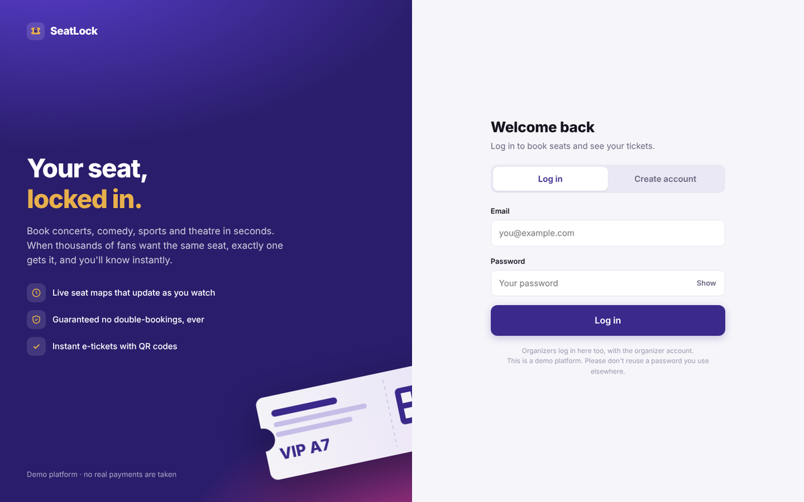 | 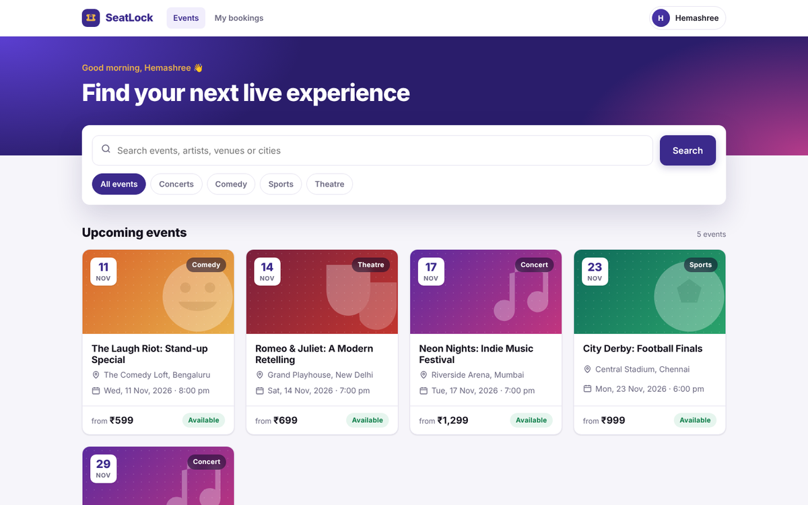 |
| **Live seat map** (Server-Sent Events) | **Seats picked, ready to hold** |
| 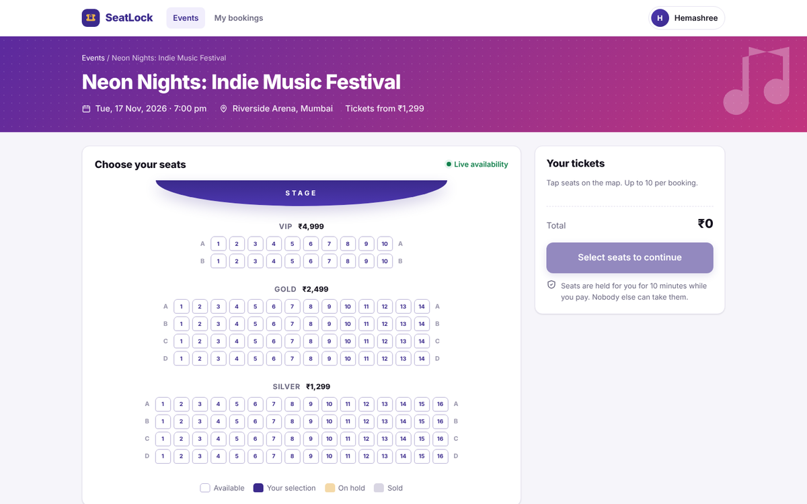 | 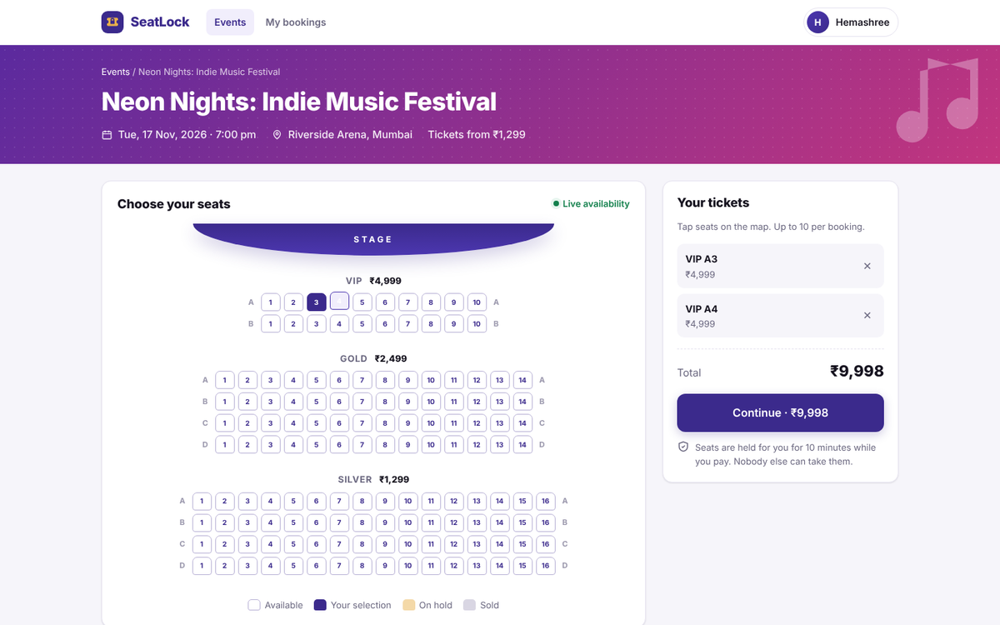 |

**The concurrency demo: 50 buyers, 1 seat.** Fifty different users fire a hold for the same seat at the same instant. Exactly one wins; the other 49 get `409 Conflict`, and the live audit still shows `0 double-bookings`:

<p align="center">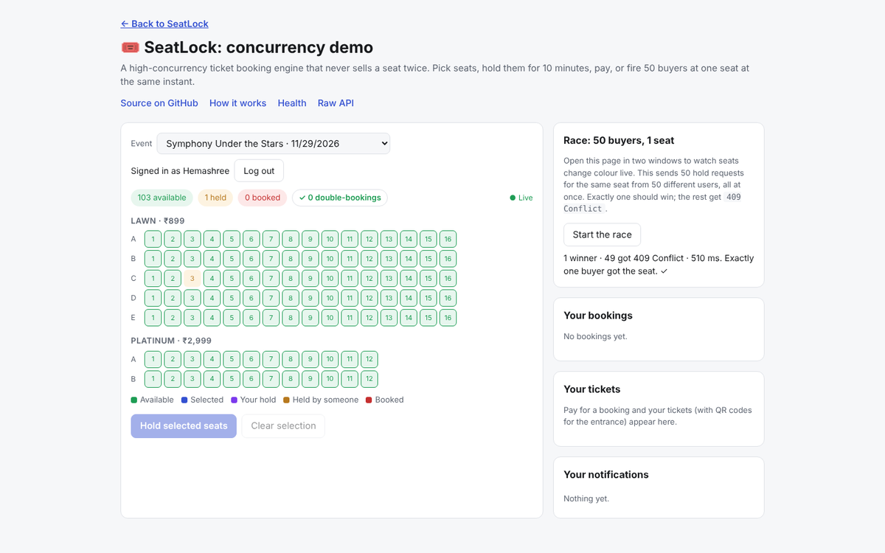</p>

---

## 🧠 How it works

> 🎬 **Visual explainer.** These frames are from the SeatLock explainer video; the full walkthrough follows below.

| | |
|---|---|
| 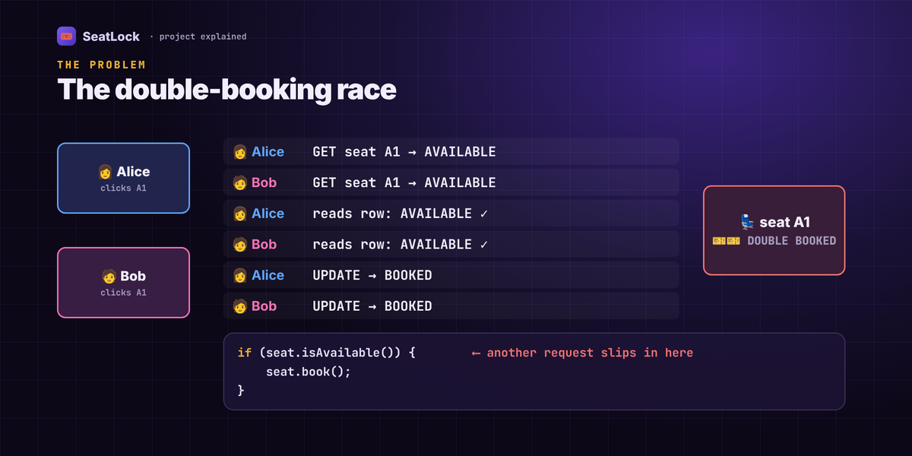 | 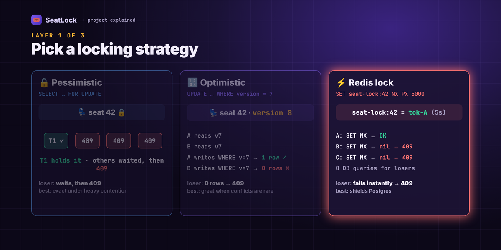 |
| 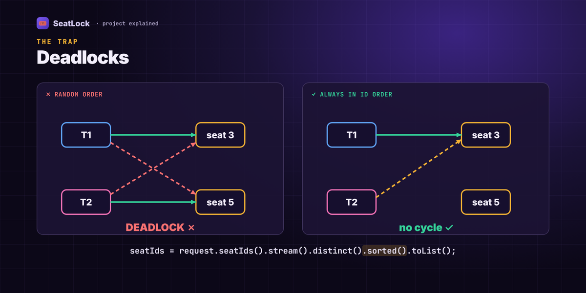 | 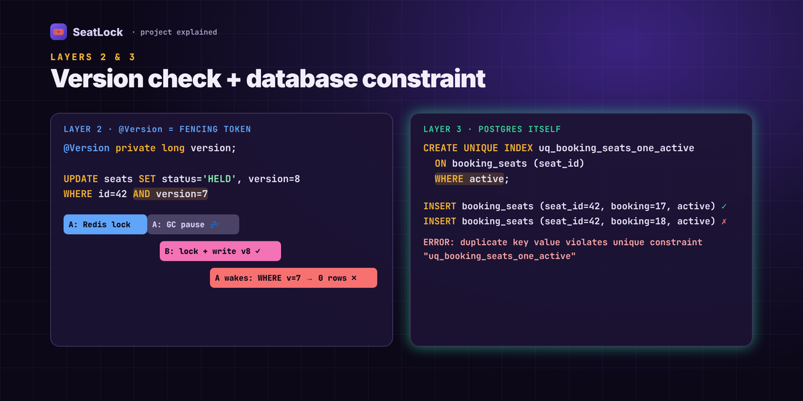 |
| 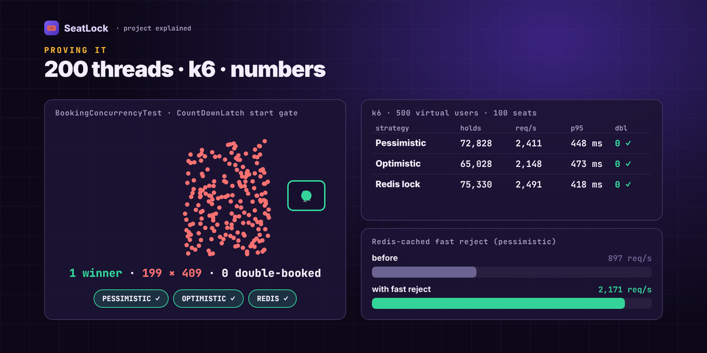 | 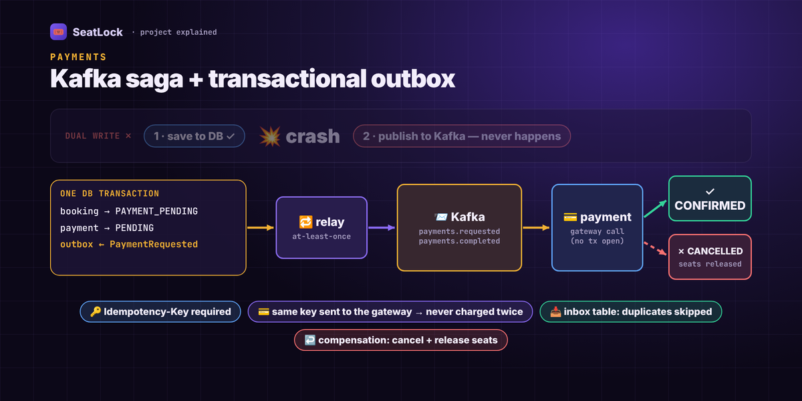 |

### The problem: the double-booking race

Two buyers load seat **A1** and both see it available. Both requests read the row (`AVAILABLE`), both write `BOOKED`. Two tickets, one seat.

```java
if (seat.isAvailable()) {   // ⟵ another request can slip in between the check…
    seat.book();            // …and the write
}
```

An `if` can't fix it: the check and the write are two separate steps. SeatLock makes the check-and-write atomic, and then backs that up twice.

### Architecture: a modular monolith

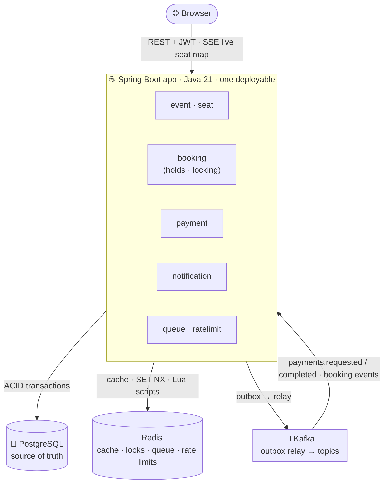

**Why not microservices?** Holding seats must update `seats`, `bookings` and `booking_seats` atomically. In one database that's a plain ACID transaction; across services it would need distributed coordination for no benefit. The seams are still clean: booking, payment and notification talk **only through Kafka messages**, so payments could be split out without touching booking code.

### Seat lifecycle: hold → pay → booked

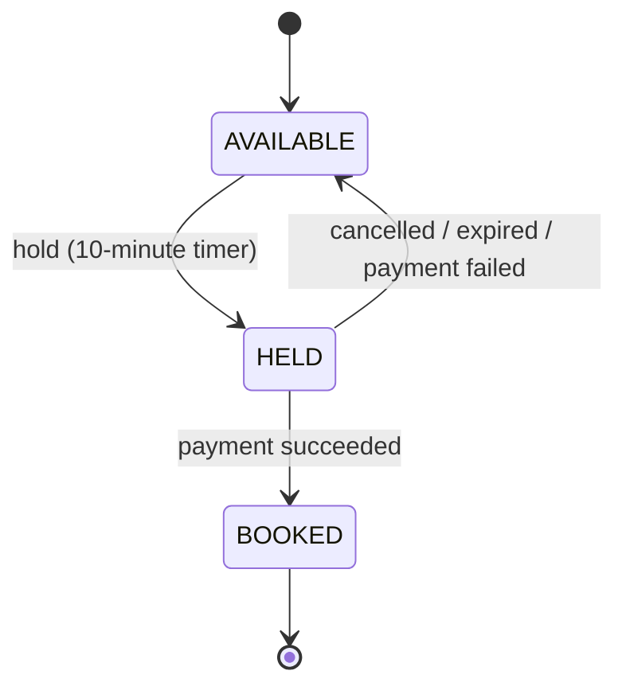

- A hold sets `expires_at = now + 10 min`.
- A sweeper runs every 5 s:
  `SELECT … WHERE status='HELD' AND expires_at < now() LIMIT 200 FOR UPDATE SKIP LOCKED`.
  `SKIP LOCKED` lets several instances expire holds in parallel without blocking each other or processing the same booking twice. A booking that is being paid holds its row lock, so the sweeper skips it.

### Defence in depth: three layers, one guarantee

Any single layer would prevent a double-booking. Together they survive bugs in each other.

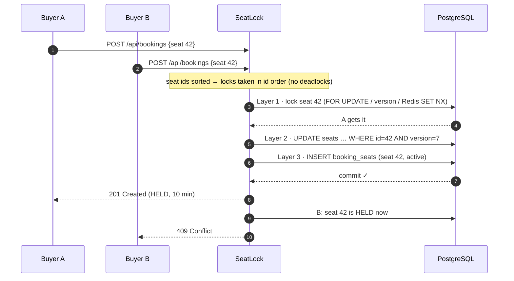

**Layer 1: a configurable locking strategy** (`seatlock.locking.strategy`)

| Strategy | How | What the loser sees | Best when |
|---|---|---|---|
| **PESSIMISTIC** (default) | `SELECT … FOR UPDATE`, rows locked **in id order** | waits for the winner to commit, sees `HELD` → `409` | high contention, exact semantics |
| **OPTIMISTIC** | read freely, `UPDATE … WHERE version = ?` | 0 rows updated → `409` | low contention |
| **REDIS** | `SET seatlock:seat-lock:{id} token NX PX 5000` | fails instantly → `409`, no DB work | many instances, shield Postgres |

**Deadlocks:** if T1 locks seat 5 then 3 while T2 locks 3 then 5, they wait on each other forever. SeatLock always sorts seat ids (`distinct().sorted()`) before locking, so that cycle can't form.

**Layer 2: `@Version` on every seat.** Every seat write is `… WHERE id = ? AND version = ?`, under every strategy. A Redis lock can expire while its owner is paused (a GC pause, a slow network), letting a second owner in. The version column acts as a **fencing token**: the stale writer's update matches 0 rows.

**Layer 3: the database itself.**

```sql
CREATE UNIQUE INDEX uq_booking_seats_one_active ON booking_seats (seat_id) WHERE active;
```

A seat can be in at most one *active* booking, enforced by PostgreSQL even if every line of application code were wrong.

**Fast reject:** after a sell-out nearly every request is doomed, so SeatLock first checks the Redis-cached seat map and rejects seats already shown as taken. It **can only reject**: a seat shown as available still goes through the locked path. This raised pessimistic throughput from **897 to 2,171 req/s**.

### Proving it

- **`BookingConcurrencyTest`** runs once per strategy (`@EnumSource`). It releases **200 threads** at the same instant with a `CountDownLatch` start gate, against real Postgres, Redis and Kafka in Testcontainers. Result: **exactly 1 winner, 199 × `409`**, and zero seats in two bookings. A second test races 200 overlapping multi-seat requests.
- **k6 load test** (`load-test/booking-rush.js`): 500 virtual users, 100 seats. It **fails the run** if `/api/events/{id}/stats` ever reports a double-booked seat. That audit covers every booking ever made, including expired and cancelled ones.
- **`/api/events/{id}/stats`** exposes `doubleBookedSeats` live (shown on the demo page).

### Payments: a Kafka saga with a transactional outbox

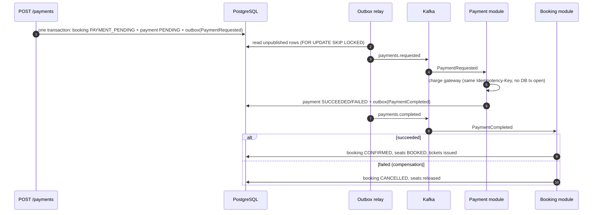

- **Why an outbox?** "Write to the DB, then publish to Kafka" can lose a message if the app crashes in between. Writing the message into `outbox_events` **in the same transaction** as the state change makes them succeed or fail together. The relay then gives **at-least-once** delivery.
- **So every consumer is idempotent:**
  - Payments require an `Idempotency-Key` (unique index, plus a fingerprint that detects a key reused for a different request → `422`).
  - The gateway gets the same key, so a redelivered message can never charge twice.
  - Notifications use an **inbox table** (`processed_messages`) to skip duplicates.
- **Ordering:** messages are keyed by booking id, so all messages for one booking land on one partition, in order.
- **Poison messages:** after 3 retries, a message is parked on a `-dlt` topic.
- **Stuck payments:** a reconciler re-drives `PENDING` payments with their original key.

### Surviving the rush

| Feature | How it works |
|---|---|
| **Virtual waiting room** | Redis sorted set (`ZADD NX` keeps your place). An admission job runs **one atomic Lua script** each second, so several instances can't over-admit. Booking requires the `X-Queue-Token`. |
| **Rate limiting** | Token bucket per user **and** per IP, as **one Lua script** (read, refill, take, write atomically, using Redis's own clock). Over the limit: `429` + `Retry-After`. Fails open if Redis is down. |
| **Seat-map cache** | Redis, evicted **after commit** (`@TransactionalEventListener(AFTER_COMMIT)`), plus a 5 s TTL safety net. Display only: holds always take the locked path. |
| **Live seat map** | Server-Sent Events. Commits mark an event *dirty*, and a flush every 300 ms sends each change once, so 1,000 holds cost a few queries, not 1,000 × viewers messages. SSE because traffic is one-way (server → browser). |
| **Accounts** | BCrypt passwords, stateless HMAC-SHA256 JWT (no sessions, so no CSRF), and the same response for wrong email or password (no account probing). |
| **E-tickets** | One per seat, 128-bit random code. Check-in is a single conditional `UPDATE … WHERE status='VALID'`: 20 simultaneous scans → 1 admitted. |

### Observability

Micrometer → Prometheus → Grafana (`docker compose --profile observability up`):

```
seatlock_holds_total{result="success",strategy="PESSIMISTIC"}     4.0
seatlock_holds_total{result="conflict",strategy="PESSIMISTIC"}  129.0
seatlock_hold_duration_seconds_max{strategy="PESSIMISTIC"}       0.422
seatlock_outbox_backlog                                           0.0
```

*(Real output from a local run after four 50-buyer races.)* Logs carry `traceId-spanId`, propagated over HTTP and Kafka headers. The public demo profile does **not** expose `/actuator/prometheus`.

### Trade-offs, honestly

- **Auth costs throughput:** verifying the JWT on every request lowered the k6 rush from **2,411 to 1,506 req/s**, still with **0 double-bookings**. The load-test table above was measured before login existed.
- **SSE subscribers live in one instance's memory:** scaling out needs Redis pub/sub fan-out.
- **Refunds aren't automated:** a provider unreachable for 15+ minutes leads to the payment failing and being logged for a refund check.
- The full list is in [`DESIGN.md` §13](./DESIGN.md#13-known-limitations-and-next-steps).


## 🌐 Live demo

The web app is a complete booking site: **log in / sign up** → **browse events** (search and categories) → **pick seats on a live seat map** → **checkout** with a 10-minute hold timer (test-mode payment) → **e-tickets with QR codes** under *My bookings* → organizer **check-in scanner**. Pages: `/login.html`, `/` (events), `/event.html`, `/checkout.html`, `/bookings.html`, `/checkin.html`, and the engineering showcase at `/demo.html`.

The engineering showcase (`/demo.html`) has: **sign up / log in**, a **live** seat map (seats turn amber/red on every open screen within a second, pushed by the server), hold / pay / cancel, **e-tickets with QR codes**, an organizer **check-in scanner** at `/checkin.html`, **email confirmations**, the live double-booking audit, and a **"50 buyers, 1 seat" race** button.

- **Deploy your own free public demo** (Render + Neon + Upstash, no credit card): see [`DEPLOY.md`](./DEPLOY.md).
- **Run it locally:** start the app (see *Getting Started*) and open http://localhost:8080/.

**Live:** https://seatlock-7ba6.onrender.com (free server: it sleeps when idle, so the first visit can take about 2 minutes to wake it up)


## 🚀 Getting Started

### Prerequisites
- Java 21
- Docker & Docker Compose

### Run locally

```bash
git clone https://github.com/HemashreeVI/seatlock-.git
cd seatlock-
```
```bash
docker compose up -d          # PostgreSQL, Redis, Kafka (ports bound to 127.0.0.1)
```
```bash
./mvnw spring-boot:run        # Windows: .\mvnw.cmd spring-boot:run
```

Or run **everything** in Docker, with no Java installed:

```bash
docker compose --profile app up -d --build
```

Prometheus + Grafana (dashboard at http://localhost:3000, anonymous view-only, log in as `admin` / `admin` to edit; Prometheus at http://localhost:9090):

```bash
docker compose --profile observability up -d
```

### Without Kafka (demo mode)

The `demo` profile runs without a message broker: the outbox delivers messages to the handlers inside the app. It's what the free public deployment uses, and it needs only Postgres and Redis:

```bash
docker compose up -d postgres redis
```
```bash
SPRING_PROFILES_ACTIVE=demo ./mvnw spring-boot:run      # Windows PowerShell: $env:SPRING_PROFILES_ACTIVE="demo"; .\mvnw.cmd spring-boot:run
```

### Verify

```bash
curl http://localhost:8080/actuator/health
```

### Run the tests

All tests start their own Postgres, Redis and Kafka containers (Docker must be running):

```bash
./mvnw verify
```


## 📖 API

| Method | Path | Description |
|---|---|---|
| `POST` | `/api/auth/register` · `/api/auth/login` | Sign up / log in → a JWT (send it as `Authorization: Bearer <token>`) |
| `POST` | `/api/auth/guest` | Throwaway guest token (no account) |
| `GET` | `/api/auth/me` | Who the token belongs to |
| `POST` | `/api/events` | **Organizer only.** Create an event; seats are generated from `sections` (`queueEnabled: true` for a waiting room) |
| `GET` | `/api/events` · `/api/events/{id}` | List / get events |
| `GET` | `/api/events/{id}/seats?status=AVAILABLE` | Seat map (cached, `X-Cache: HIT/MISS`) |
| `GET` | `/api/events/{id}/seats/stream` | Live seat statuses (Server-Sent Events) |
| `GET` | `/api/events/{id}/stats` | Seats and bookings by status, **double-booked seat count** |
| `POST` | `/api/events/{id}/queue` · `GET` same | Join the waiting room / poll position and admission token |
| `POST` | `/api/bookings` | Hold seats for the logged-in user (optional `Idempotency-Key`; `X-Queue-Token` for hot events). Notifications go to the account's email |
| `GET` | `/api/bookings` | Your recent bookings |
| `GET` | `/api/bookings/{id}` | Booking status |
| `DELETE` | `/api/bookings/{id}` | Cancel a hold, release the seats |
| `POST` | `/api/bookings/{id}/payments` | Pay (requires `Idempotency-Key`); `202 Accepted` |
| `GET` | `/api/payments/{id}` | Payment status |
| `GET` | `/api/notifications` | Your notifications |
| `GET` | `/api/tickets` | Your e-tickets (one per seat of each paid booking) |
| `GET` | `/api/tickets/{id}/qr.png` | The ticket's QR code |
| `POST` | `/api/tickets/check-in` · `/api/tickets/check-in/scan` | **Organizer only.** Check a ticket in by code, or from a photo of its QR code → `ADMITTED` / `ALREADY_USED` / `INVALID` |

Everything except browsing events and seats needs a login. Organizer endpoints need the account set by `ADMIN_EMAIL` / `ADMIN_PASSWORD`.

Errors use the standard [RFC 9457](https://www.rfc-editor.org/rfc/rfc9457) problem-details JSON: `400` invalid input, `401` not logged in, `403` organizer only / waiting-room admission required, `404` not found, `409` seat taken / wrong state, `422` idempotency key reused for a different request, `429` rate limited (with `Retry-After`).

### Example (bash)

The example uses [`jq`](https://jqlang.org/) to pick values out of each response. Start the app with an organizer account, e.g. `ADMIN_EMAIL=me@example.com ADMIN_PASSWORD=change-me-123`.

```bash
# log in as the organizer and create an event
ADMIN=$(curl -s -X POST localhost:8080/api/auth/login -H 'Content-Type: application/json' \
  -d '{"email": "me@example.com", "password": "change-me-123"}' | jq -r .token)
EVENT_ID=$(curl -s -X POST localhost:8080/api/events -H "Authorization: Bearer $ADMIN" -H 'Content-Type: application/json' -d '{
  "name": "Coldplay Live", "venue": "DY Patil Stadium", "startsAt": "2027-01-20T19:00:00Z",
  "sections": [{"name": "VIP", "rows": 2, "seatsPerRow": 5, "priceCents": 500000}]}' | jq -r .id)
```
```bash
# a fan signs up, holds two seats and pays
TOKEN=$(curl -s -X POST localhost:8080/api/auth/register -H 'Content-Type: application/json' \
  -d '{"name": "Alice", "email": "alice@example.com", "password": "alice-pass-1"}' | jq -r .token)
SEATS=$(curl -s localhost:8080/api/events/$EVENT_ID/seats | jq -c '[.[0].id, .[1].id]')
BOOKING_ID=$(curl -s -X POST localhost:8080/api/bookings -H "Authorization: Bearer $TOKEN" -H 'Content-Type: application/json' \
  -H 'Idempotency-Key: hold-1' -d "{\"eventId\": $EVENT_ID, \"seatIds\": $SEATS}" | jq -r .id)
curl -s -X POST localhost:8080/api/bookings/$BOOKING_ID/payments -H "Authorization: Bearer $TOKEN" \
  -H 'Content-Type: application/json' -H 'Idempotency-Key: pay-1' -d '{"paymentToken": "tok_visa"}'
```
```bash
# a moment later: two tickets; the organizer checks the first one in (a second scan says ALREADY_USED)
CODE=$(curl -s localhost:8080/api/tickets -H "Authorization: Bearer $TOKEN" | jq -r '.[0].code')
curl -s -X POST localhost:8080/api/tickets/check-in -H "Authorization: Bearer $ADMIN" \
  -H 'Content-Type: application/json' -d "{\"code\": \"$CODE\"}" | jq .result
```


## 📁 Project Structure

```
src/main/java/com/HemashreeVI/seatlock/
├── event/          events, seat generation, stats
├── seat/           seat entity, seat map + Redis cache
├── auth/           sign-up / log-in, JWT, security rules, organizer account
├── ticket/         e-tickets, QR codes, check-in
├── booking/        holds, cancel, expiry sweeper, saga listener
│   └── locking/    optimistic / pessimistic / Redis strategies
├── payment/        idempotent payment requests, processor, fake gateway
├── notification/   notification consumer (inbox de-duplication)
├── messaging/      outbox, relay, topics, message payloads
├── queue/          virtual waiting room
├── ratelimit/      token bucket filter
├── observability/  business metrics
├── config/         typed configuration, Kafka, scheduling
└── common/         errors -> problem-details JSON
src/main/resources/static/          web app: login, events, event (seat map), checkout, bookings, check-in; demo.html; assets/ (shared CSS/JS)
src/main/resources/db/migration/   Flyway V1..V7
load-test/                         k6 script
observability/                     Prometheus config, Grafana dashboard
```


## 🗺️ Roadmap

- [x] Project setup with Docker Compose (PostgreSQL, Redis)
- [x] **Stage 1:** Core domain: events, seats, bookings, REST APIs
- [x] **Stage 2:** Concurrency control, seat holds, idempotency
- [x] **Stage 3:** Kafka-based payment & notification flow, outbox pattern, saga
- [x] **Stage 4:** Caching, rate limiting, virtual waiting queue
- [x] **Stage 5:** Observability, load testing, design document
- [x] Live seat map (Server-Sent Events), email notifications
- [x] Accounts and login (Spring Security + JWT), e-tickets with QR codes, check-in scanner
- [ ] Next: refund flow for late payment results, multi-instance load test


## 📄 Design Decisions

Locking strategies, consistency choices, failure handling and known limitations are explained in [`DESIGN.md`](./DESIGN.md).

<p align="center">
  
</p>
