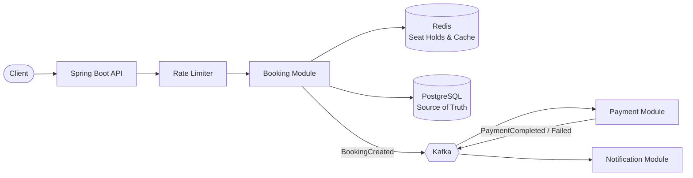

# 🎟️ SeatLock

> High-concurrency ticket booking engine built with Spring Boot, Redis & Kafka — designed to guarantee **zero double-bookings** under thousands of simultaneous requests.


---

## 📌 The Problem

When a popular event goes on sale, thousands of users try to book the same limited seats at the same moment. A naive booking system fails in three ways:

1. **Double-booking:** two users read "seat available" at the same time and both get the seat.
2. **System overload:** a sudden traffic spike overwhelms the database.
3. **Duplicate payments:** a network retry or double-click charges the user twice.

**SeatLock** is a backend system designed to handle exactly this scenario correctly, reliably, and at scale.

---

## ✨ Features

| Feature | Description | Status |
|---|---|---|
| Event & seat management | Create events, seat layouts, and query availability | 🔜 Planned |
| Temporary seat holds | Seats are held for 10 minutes and auto-released on timeout | 🔜 Planned |
| Concurrency control | Prevents double-booking via optimistic, pessimistic & distributed locking | 🔜 Planned |
| Idempotent payments | Retried requests never result in duplicate charges | 🔜 Planned |
| Event-driven workflow | Booking → payment → notification via Kafka | 🔜 Planned |
| Saga with compensation | Failed payments automatically release reserved seats | 🔜 Planned |
| Rate limiting | Token-bucket limiter to block abusive traffic | 🔜 Planned |
| Virtual waiting queue | Absorbs traffic spikes instead of crashing | 🔜 Planned |
| Observability | Metrics, dashboards, and tracing with Prometheus & Grafana | 🔜 Planned |

---

## 🏗️ Architecture

SeatLock is built as a **modular monolith**, a single deployable application with strictly separated modules, so individual modules can be extracted into microservices later if needed.



### Booking Flow

1. **Browse:** the user views available seats (served from cache).
2. **Hold:** the selected seat is locked for the user with a 10-minute TTL.
3. **Pay:** the payment request is processed with an idempotency key.
4. **Confirm:** on success, the booking is confirmed and an event is published.
5. **Release:** on failure or timeout, the seat is automatically returned to inventory.

---

## 🛠️ Tech Stack

| Layer | Technology |
|---|---|
| Language | Java 21 |
| Framework | Spring Boot 3, Spring Data JPA, Spring Security |
| Database | PostgreSQL 16 + Flyway migrations |
| Cache & Locks | Redis 7 |
| Messaging | Apache Kafka |
| Testing | JUnit 5, Testcontainers |
| Load Testing | k6 |
| Observability | Micrometer, Prometheus, Grafana |
| DevOps | Docker Compose, GitHub Actions |

---

## 🚀 Getting Started

### Prerequisites
- Java 21
- Docker & Docker Compose

### Run Locally

```bash
# 1. Clone the repository
git clone https://github.com/<your-username>/seatlock.git
cd seatlock

# 2. Start infrastructure (PostgreSQL, Redis)
docker compose up -d

# 3. Run the application
./mvnw spring-boot:run
```

### Verify

```bash
curl http://localhost:8080/actuator/health
# {"status":"UP"}
```

---

## 📊 Load Test Results

> 🚧 Coming soon. This section will show results for N concurrent users booking a limited number of seats, including total bookings, double-bookings detected, throughput, and p50/p95/p99 latency.

---

## 🗺️ Roadmap

- [x] Project setup with Docker Compose (PostgreSQL, Redis)
- [ ] **Stage 1:** Core domain: events, seats, bookings, REST APIs
- [ ] **Stage 2:** Concurrency control, seat holds, idempotency
- [ ] **Stage 3:** Kafka-based payment & notification flow, outbox pattern, saga
- [ ] **Stage 4:** Caching, rate limiting, virtual waiting queue
- [ ] **Stage 5:** Observability, load testing, design document

---

## 📄 Design Decisions

Detailed trade-offs (locking strategies, consistency choices, failure handling) will be documented in [`DESIGN.md`](./DESIGN.md).

---

