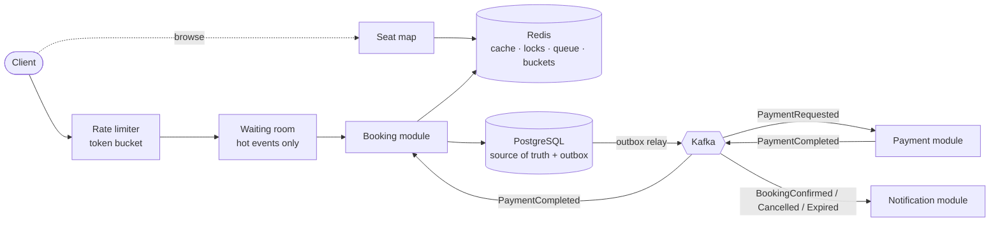

# 🎟️ SeatLock

> High-concurrency ticket booking engine built with Spring Boot, Redis & Kafka — designed to guarantee **zero double-bookings** under thousands of simultaneous requests.


---

## 📌 The Problem

When a popular event goes on sale, thousands of users try to book the same limited seats at the same moment. A naive booking system fails in three ways:

1. **Double-booking:** two users read "seat available" at the same time and both get the seat.
2. **System overload:** a sudden traffic spike overwhelms the database.
3. **Duplicate payments:** a network retry or double-click charges the user twice.

**SeatLock** is a backend system designed to handle exactly this scenario correctly, reliably, and at scale.

---

## 🌐 Live demo

Open `/` on a running instance for an interactive demo: a seat map where you can hold, pay and cancel, see notifications and the live double-booking audit, and a **"50 buyers, 1 seat" race** button.

- **Deploy your own free public demo** (Render + Neon + Upstash, no credit card): see [`DEPLOY.md`](./DEPLOY.md).
- **Run it locally:** start the app (see *Getting Started*) and open http://localhost:8080/.

<!-- Once deployed, replace this line with: **Live:** https://seatlock-xxxx.onrender.com (the free server sleeps when idle; the first visit takes ~2 min to wake it) -->

---

## ✨ Features

| Feature | Description | Status |
|---|---|---|
| Event & seat management | Create events with generated seat layouts, query availability | ✅ Done |
| Temporary seat holds | Seats are held for 10 minutes and auto-released on timeout | ✅ Done |
| Concurrency control | Optimistic, pessimistic & Redis distributed locking (switchable), backed by DB constraints | ✅ Done |
| Idempotent requests | `Idempotency-Key` on holds and payments: retries never double-book or double-charge | ✅ Done |
| Event-driven workflow | Booking → payment → notification via Kafka, transactional outbox | ✅ Done |
| Saga with compensation | Failed payments automatically release reserved seats | ✅ Done |
| Seat-map caching | Seat map served from Redis, evicted on every change | ✅ Done |
| Rate limiting | Distributed token-bucket limiter (Redis + Lua) | ✅ Done |
| Virtual waiting queue | FIFO waiting room with admission tokens for hot events | ✅ Done |
| Observability | Prometheus metrics, Grafana dashboard, trace ids in logs | ✅ Done |

---

## 🏗️ Architecture

SeatLock is a **modular monolith**: one deployable application with strictly separated modules (`event`, `seat`, `booking`, `payment`, `notification`, `queue`, `ratelimit`, `messaging`). Modules talk through Kafka where it matters, so any of them could be extracted into a microservice later.



### Booking flow

1. **Browse:** `GET /api/events/{id}/seats` is served from the Redis cache.
2. **(Hot events) Queue:** join the waiting room, get an admission token when it's your turn.
3. **Hold:** `POST /api/bookings` locks the seats for 10 minutes (seat → `HELD`).
4. **Pay:** `POST /api/bookings/{id}/payments` with an `Idempotency-Key` returns `202 Accepted`. The booking moves to `PAYMENT_PENDING` and a `PaymentRequested` message goes to the outbox.
5. **Confirm:** the payment module charges the gateway; on success the booking becomes `CONFIRMED` and the seats `BOOKED`.
6. **Release:** on payment failure (saga compensation), cancellation or timeout, the seats go back to `AVAILABLE`.
7. **Notify:** every confirmed/cancelled/expired booking produces exactly one notification.

---

## 🛠️ Tech Stack

| Layer | Technology |
|---|---|
| Language | Java 21 (virtual threads) |
| Framework | Spring Boot 4.1, Spring Data JPA (Hibernate 7), Spring Kafka |
| Database | PostgreSQL 16 + Flyway migrations |
| Cache, locks, queue, rate limits | Redis 7 (Lua scripts for atomic operations) |
| Messaging | Apache Kafka 4.1 (KRaft) |
| Testing | JUnit 5, Testcontainers (real Postgres, Redis, Kafka), Awaitility |
| Load testing | k6 |
| Observability | Micrometer, Prometheus, Grafana, Micrometer Tracing (Brave) |
| DevOps | Docker, Docker Compose, GitHub Actions |

> Authentication is out of scope for now: callers identify themselves with an `X-User-Id` header. Spring Security (JWT) would replace this.

---

## 🚀 Getting Started

### Prerequisites
- Java 21
- Docker & Docker Compose

### Run locally

```bash
git clone https://github.com/HemashreeVI/seatlock-.git
cd seatlock-
```
```bash
docker compose up -d          # PostgreSQL, Redis, Kafka (ports bound to 127.0.0.1)
```
```bash
./mvnw spring-boot:run        # Windows: .\mvnw.cmd spring-boot:run
```

Or run **everything** in Docker, with no Java installed:

```bash
docker compose --profile app up -d --build
```

Prometheus + Grafana (dashboard at http://localhost:3000, anonymous view-only, log in as `admin` / `admin` to edit; Prometheus at http://localhost:9090):

```bash
docker compose --profile observability up -d
```

### Without Kafka (demo mode)

The `demo` profile runs without a message broker: the outbox delivers messages to the handlers inside the app. It's what the free public deployment uses, and it needs only Postgres and Redis:

```bash
docker compose up -d postgres redis
```
```bash
SPRING_PROFILES_ACTIVE=demo ./mvnw spring-boot:run      # Windows PowerShell: $env:SPRING_PROFILES_ACTIVE="demo"; .\mvnw.cmd spring-boot:run
```

### Verify

```bash
curl http://localhost:8080/actuator/health
```

### Run the tests

All tests start their own Postgres, Redis and Kafka containers (Docker must be running):

```bash
./mvnw verify
```

---

## 📖 API

| Method | Path | Description |
|---|---|---|
| `POST` | `/api/events` | Create an event; seats are generated from `sections` (`queueEnabled: true` for a waiting room) |
| `GET` | `/api/events` · `/api/events/{id}` | List / get events |
| `GET` | `/api/events/{id}/seats?status=AVAILABLE` | Seat map (cached, `X-Cache: HIT/MISS`) |
| `GET` | `/api/events/{id}/stats` | Seats and bookings by status, **double-booked seat count** |
| `POST` | `/api/events/{id}/queue` · `GET` same | Join the waiting room / poll position and admission token |
| `POST` | `/api/bookings` | Hold seats (headers: `X-User-Id`, optional `Idempotency-Key`, `X-Queue-Token` for hot events) |
| `GET` | `/api/bookings/{id}` | Booking status |
| `DELETE` | `/api/bookings/{id}` | Cancel a hold, release the seats |
| `POST` | `/api/bookings/{id}/payments` | Pay (requires `Idempotency-Key`); `202 Accepted` |
| `GET` | `/api/payments/{id}` | Payment status |
| `GET` | `/api/notifications` | Your notifications |

Errors use the standard [RFC 9457](https://www.rfc-editor.org/rfc/rfc9457) problem-details JSON: `400` invalid input, `403` waiting-room admission required, `404` not found, `409` seat taken / wrong state, `422` idempotency key reused for a different request, `429` rate limited (with `Retry-After`).

### Example (bash)

The example uses [`jq`](https://jqlang.org/) to pick the ids out of each response, so it works even if your database already contains other events.

```bash
# create an event with 2 sections and remember its id
EVENT_ID=$(curl -s -X POST localhost:8080/api/events -H 'Content-Type: application/json' -d '{
  "name": "Coldplay Live", "venue": "DY Patil Stadium", "startsAt": "2027-01-20T19:00:00Z",
  "sections": [
    {"name": "VIP",     "rows": 2, "seatsPerRow": 5,  "priceCents": 500000},
    {"name": "GENERAL", "rows": 3, "seatsPerRow": 10, "priceCents": 150000}
  ]}' | jq -r .id)
```
```bash
# the ids of the first two seats of that event
SEATS=$(curl -s localhost:8080/api/events/$EVENT_ID/seats | jq -c '[.[0].id, .[1].id]')
```
```bash
# hold them for 10 minutes and remember the booking id
BOOKING_ID=$(curl -s -X POST localhost:8080/api/bookings -H 'Content-Type: application/json' \
  -H 'X-User-Id: alice' -H 'Idempotency-Key: hold-1' \
  -d "{\"eventId\": $EVENT_ID, \"seatIds\": $SEATS}" | jq -r .id)
```
```bash
# pay ("tok_fail..." simulates a declined card)
curl -s -X POST localhost:8080/api/bookings/$BOOKING_ID/payments -H 'Content-Type: application/json' \
  -H 'X-User-Id: alice' -H 'Idempotency-Key: pay-1' -d '{"paymentToken": "tok_visa"}'
```
```bash
# a moment later: CONFIRMED, seats BOOKED
curl -s localhost:8080/api/bookings/$BOOKING_ID -H 'X-User-Id: alice'
```

---

## 📊 Load Test Results

[`load-test/booking-rush.js`](./load-test/booking-rush.js): **500 concurrent users** hammering **100 seats** for **30 s** with no think time. Each user requests 1–2 seats, biased towards the front rows. The test exercises the **hold** path; it doesn't pay. At the end it calls `/stats`, whose audit counts every seat that was *ever* owned by two bookings at overlapping times, including bookings that later expired or were cancelled. The run fails if that count isn't 0, or if nobody managed to hold a seat at all.

All load-test traffic comes from one IP, so to measure the booking path itself the app is started with rate limiting off:

```bash
java -Dseatlock.rate-limit.enabled=false -jar target/seatlock-0.0.1-SNAPSHOT.jar
```
```bash
k6 run -e VUS=500 -e SEATS=100 -e DURATION=30s load-test/booking-rush.js
```

| Locking strategy | Hold requests | Throughput | p50 | p95 | p99 | Seats held | **Double-bookings** |
|---|---|---|---|---|---|---|---|
| Pessimistic (`FOR UPDATE`) | 72,828 | 2,411 req/s | 171 ms | 448 ms | 694 ms | 100 / 100 | **0** |
| Optimistic (`@Version`) | 65,028 | 2,148 req/s | 187 ms | 473 ms | 760 ms | 100 / 100 | **0** |
| Redis distributed lock | 75,330 | 2,491 req/s | 166 ms | 418 ms | 629 ms | 100 / 100 | **0** |

Effect of the fast-reject pre-check (requests for seats the cached seat map already shows as taken get a 409 without touching the database), measured in an earlier round of the same test:

| Strategy | Without fast-reject | With fast-reject |
|---|---|---|
| Pessimistic | 897 req/s, p95 1.26 s | 2,171 req/s, p95 417 ms |
| Optimistic | 1,077 req/s, p95 1.05 s | 2,153 req/s, p95 412 ms |
| Redis lock | 1,954 req/s, p95 498 ms | 2,330 req/s, p95 370 ms |

**With rate limiting on** (default settings, pessimistic): the single-IP flood of 260,459 requests got `429` for 99.4% of them. Those were answered from Redis in p95 95 ms, and the 100 seats were still all held with 0 double-bookings.

> Measured on a single 4-vCPU / 15 GB machine running k6, the app, PostgreSQL, Redis and Kafka **together**, so the absolute numbers are bounded by that box. Each run used a fresh JVM after a 15 s warm-up. With 500 users and zero think time, most of the latency is queueing; at 100 users (pessimistic, without fast-reject) the p95 was 173 ms. The point of the test is the last column: across more than 500,000 contended hold attempts in these runs, **no seat was ever held by two bookings at the same time**.

The concurrency tests in [`BookingConcurrencyTest`](./src/test/java/com/HemashreeVI/seatlock/booking/BookingConcurrencyTest.java) check the same guarantee on every build: 200 threads racing for one seat give exactly one winner under each strategy, and 200 overlapping multi-seat requests never put a seat in two bookings.

---

## 🗺️ Roadmap

- [x] Project setup with Docker Compose (PostgreSQL, Redis)
- [x] **Stage 1:** Core domain: events, seats, bookings, REST APIs
- [x] **Stage 2:** Concurrency control, seat holds, idempotency
- [x] **Stage 3:** Kafka-based payment & notification flow, outbox pattern, saga
- [x] **Stage 4:** Caching, rate limiting, virtual waiting queue
- [x] **Stage 5:** Observability, load testing, design document
- [ ] Next: Spring Security (JWT), refund flow for late payment results, multi-instance load test

---

## 📁 Project Structure

```
src/main/java/com/HemashreeVI/seatlock/
├── event/          events, seat generation, stats
├── seat/           seat entity, seat map + Redis cache
├── booking/        holds, cancel, expiry sweeper, saga listener
│   └── locking/    optimistic / pessimistic / Redis strategies
├── payment/        idempotent payment requests, processor, fake gateway
├── notification/   notification consumer (inbox de-duplication)
├── messaging/      outbox, relay, topics, message payloads
├── queue/          virtual waiting room
├── ratelimit/      token bucket filter
├── observability/  business metrics
├── config/         typed configuration, Kafka, scheduling
└── common/         errors -> problem-details JSON
src/main/resources/db/migration/   Flyway V1..V4
load-test/                         k6 script
observability/                     Prometheus config, Grafana dashboard
```

---

## 📄 Design Decisions

Locking strategies, consistency choices, failure handling and known limitations are explained in [`DESIGN.md`](./DESIGN.md).
