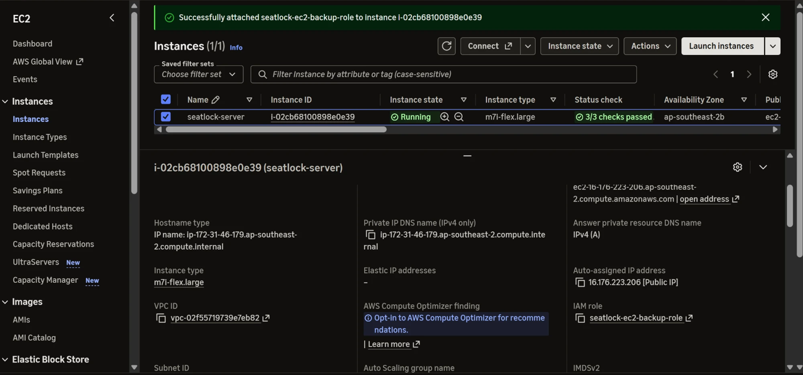
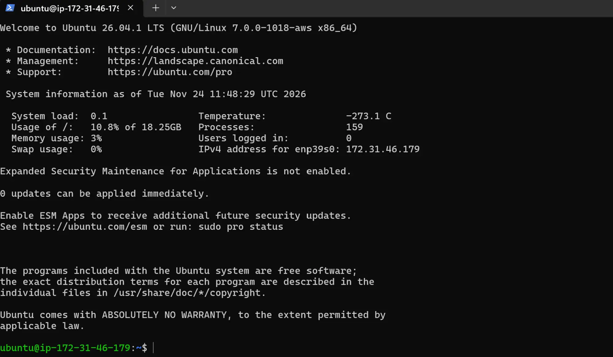
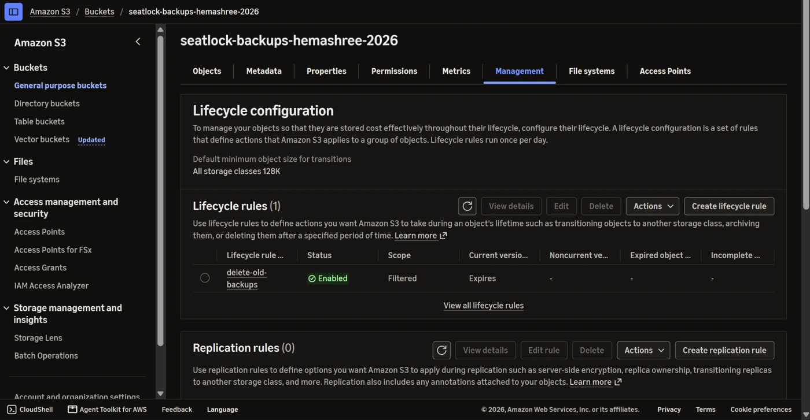

# Deploying SeatLock on AWS (EC2 + S3)

SeatLock runs on a single **Amazon EC2** instance with the **full stack**: the Spring Boot app, PostgreSQL, Redis and **real Kafka**, all from the repository's `docker-compose.yml`. Database backups go to **Amazon S3** every night, using an **IAM role** instead of access keys.

This complements [`DEPLOY.md`](../../DEPLOY.md) (free Render + Neon + Upstash demo without Kafka). The AWS setup runs the complete Kafka saga.

---

## Architecture

```
                     Browser  ──  http://<public-ip>:8080
                                      │
 ┌──────────────────── AWS · ap-southeast-2 (Sydney) ─────────────────────┐
 │  Security group:  8080 ← anywhere      22 (SSH) ← my IP only (/32)     │
 │  ┌──────────────── EC2 m7i-flex.large · Ubuntu · 20 GB gp3 ─────────┐  │
 │  │  Docker Compose                                                  │  │
 │  │   ├─ seatlock-app       Spring Boot (Java 21)   0.0.0.0:8080     │  │
 │  │   ├─ seatlock-postgres  PostgreSQL 16           127.0.0.1:5432   │  │
 │  │   ├─ seatlock-redis     Redis 7                 127.0.0.1:6379   │  │
 │  │   └─ seatlock-kafka     Kafka 4.1 (KRaft)       127.0.0.1:9092   │  │
 │  │                                                                  │  │
 │  │  cron 02:00 IST → backup-to-s3.sh ── pg_dump | gzip ─────────────┼──┼──► S3 bucket (private)
 │  │  IAM role: seatlock-ec2-backup-role (least privilege)            │  │     postgres/*.sql.gz
 │  └──────────────────────────────────────────────────────────────────┘  │     lifecycle: expire after 30 days
 └────────────────────────────────────────────────────────────────────────┘
```

| Concern | How it's handled |
|---|---|
| **Network exposure** | Only port 8080 is public. SSH is limited to one IP. Postgres, Redis and Kafka have **no** security-group rule **and** are bound to `127.0.0.1` in `docker-compose.yml`, so there are two layers of protection. |
| **SSH access** | Key-pair authentication (no passwords). |
| **AWS credentials** | The instance gets temporary credentials from its **IAM role** via IMDSv2. No access keys are stored on the server. |
| **Restarts** | `restart: unless-stopped`, so the containers come back by themselves after the instance is stopped and started. |
| **Backups** | A nightly `pg_dump` is streamed to a private S3 bucket. A lifecycle rule deletes backups after 30 days. |
| **Cost control** | The instance is stopped when not in use. Budget alerts are set in Billing. |

### Screenshots

| EC2 instance (running, IAM role attached) | SSH into the Ubuntu server |
|---|---|
|  |  |
| **SeatLock served from EC2** | **S3 backup bucket lifecycle rule** |
|  |  |

---

## 1. Launch the EC2 instance (AWS Console)

| Setting | Value | Why |
|---|---|---|
| AMI | Ubuntu Server LTS | Docker installs easily |
| Instance type | `m7i-flex.large` (2 vCPU, 8 GB) | Kafka + JVM + Postgres + Redis need about 3 GB. A 1 GB instance runs out of memory. |
| Key pair | New RSA key, `.pem` | SSH login |
| Security group | SSH 22 from **My IP**; Custom TCP **8080** from anywhere | Public website, private admin access |
| Storage | 20 GiB gp3 | Images, Kafka log, Postgres data |

Connect from Windows PowerShell (the OpenSSH client is built in):

```powershell
icacls "$HOME\.ssh\seatlock-key.pem" /inheritance:r /grant:r "$($env:USERNAME):R"
ssh -i "$HOME\.ssh\seatlock-key.pem" ubuntu@<public-ip>
```

## 2. Install Docker and start the stack (on the instance)

```bash
# 2 GB swap as a safety net during the Maven build
sudo fallocate -l 2G /swapfile && sudo chmod 600 /swapfile && sudo mkswap /swapfile \
  && sudo swapon /swapfile && echo '/swapfile none swap sw 0 0' | sudo tee -a /etc/fstab

curl -fsSL https://get.docker.com | sudo sh
sudo usermod -aG docker ubuntu        # then log out and back in

git clone https://github.com/HemashreeVI/SeatLock.git && cd SeatLock
cp deploy/aws/docker-compose.override.example.yml docker-compose.override.yml
sed -i "s|CHANGE-ME|$(openssl rand -base64 48)|" docker-compose.override.yml

docker compose --profile app up -d --build     # first build takes 5-10 minutes
docker compose ps                              # app, postgres, redis, kafka: Up
curl http://localhost:8080/actuator/health     # {"status":"UP", ...}
```

Health check output on the instance (abridged):

```json
{"components":{"db":{"details":{"database":"PostgreSQL"},"status":"UP"},
 "redis":{"details":{"version":"7.4.12"},"status":"UP"},
 "livenessState":{"status":"UP"},"readinessState":{"status":"UP"}},"status":"UP"}
```

Open `http://<public-ip>:8080/` (plain HTTP) and `http://<public-ip>:8080/demo.html` for the "50 buyers, 1 seat" race.

Check that the Kafka saga is running:

```bash
docker compose exec kafka /opt/kafka/bin/kafka-topics.sh --bootstrap-server localhost:9092 --list
docker compose exec kafka /opt/kafka/bin/kafka-console-consumer.sh --bootstrap-server localhost:9092 \
  --include 'seatlock\..*' --from-beginning --property print.key=true
```

## 3. Nightly backups to S3

### 3.1 S3 bucket
- A **general purpose bucket** in the same region, with **Block all public access** ON and default SSE-S3 encryption.
- **Lifecycle rule** `delete-old-backups`: prefix `postgres/`, *expire current versions* after **30 days**. Optionally also *delete incomplete multipart uploads* after 7 days.

### 3.2 IAM role (no access keys on the server)
1. IAM → Roles → Create role → trusted entity **AWS service → EC2** → no managed policies → name `seatlock-ec2-backup-role`.
2. Add an **inline policy** from [`iam-backup-policy.json`](./iam-backup-policy.json), with your bucket name in place of `YOUR-BACKUP-BUCKET`. It only allows reading and writing objects under `postgres/` in that one bucket, plus listing it (least privilege; no delete).
3. EC2 → instance → Actions → Security → **Modify IAM role** → `seatlock-ec2-backup-role`.

### 3.3 Script and schedule (on the instance)

```bash
sudo snap install aws-cli --classic
aws sts get-caller-identity            # Arn shows assumed-role/seatlock-ec2-backup-role

cp ~/SeatLock/deploy/aws/backup-to-s3.sh ~/backup-to-s3.sh && chmod +x ~/backup-to-s3.sh
BACKUP_BUCKET=<your-bucket> ~/backup-to-s3.sh
aws s3 ls s3://<your-bucket>/postgres/

# every night at 20:30 UTC (02:00 IST)
(crontab -l 2>/dev/null; echo "30 20 * * * BACKUP_BUCKET=<your-bucket> /home/ubuntu/backup-to-s3.sh >> /home/ubuntu/backup.log 2>&1") | crontab -
```

First run on the instance:

```
backup uploaded: s3://seatlock-backups-…/postgres/seatlock-2026-11-24_1229.sql.gz
2026-11-24 12:29:16       8301 seatlock-2026-11-24_1229.sql.gz
```

### 3.4 Restore test (into a separate database)

```bash
docker exec seatlock-postgres createdb -U seatlock restore_test
LATEST=$(aws s3 ls s3://<your-bucket>/postgres/ | sort | tail -n 1 | awk '{print $4}')
aws s3 cp "s3://<your-bucket>/postgres/$LATEST" - | gunzip | docker exec -i seatlock-postgres psql -q -U seatlock -d restore_test
docker exec seatlock-postgres psql -U seatlock -d restore_test -c "SELECT count(*) FROM bookings;"
docker exec seatlock-postgres dropdb -U seatlock restore_test
```

> Cron only fires while the instance is running. Run the script by hand before stopping the instance if the data matters.

## 4. Day-to-day operations

| Task | How |
|---|---|
| Stop paying for compute | EC2 → Instance state → **Stop** (the disk and data are kept) |
| Start again | **Start**, wait about 2 minutes. ⚠️ The **public IP changes**: use the new one, or attach an Elastic IP. |
| Deploy new code | `cd ~/SeatLock && git pull && docker compose --profile app up -d --build` |
| Logs | `docker compose logs -f app` |
| Tear down | Terminate the instance; empty and delete the bucket; delete the role |

## 5. Why this design, and what production would change

- **Why one EC2 instance?** It's the cheapest way to run the **complete** stack, including Kafka, with the same Compose file used locally. Managed equivalents (RDS, ElastiCache, MSK) would cost far more for a demo.
- **Why not Lambda?** SeatLock holds long-lived SSE connections, runs continuous scheduled jobs (hold sweeper, outbox relay, reconciler) and Kafka consumers, which suit a long-running service better.

| Limitation (current) | Production approach |
|---|---|
| Single instance: a single point of failure | ECS Fargate service across AZs behind an Application Load Balancer |
| Plain HTTP on :8080 | ALB + ACM certificate (HTTPS) and a domain in Route 53 |
| Self-managed Postgres / Redis / Kafka | RDS PostgreSQL (PITR backups, Multi-AZ), ElastiCache Redis, Amazon MSK |
| Nightly logical dumps | RDS automated backups + snapshots |
| Public IP changes on stop/start | Elastic IP, or DNS on a load balancer |
| `/actuator/prometheus` reachable on :8080 | Expose only through the ALB with path rules, or keep management on a private port |
